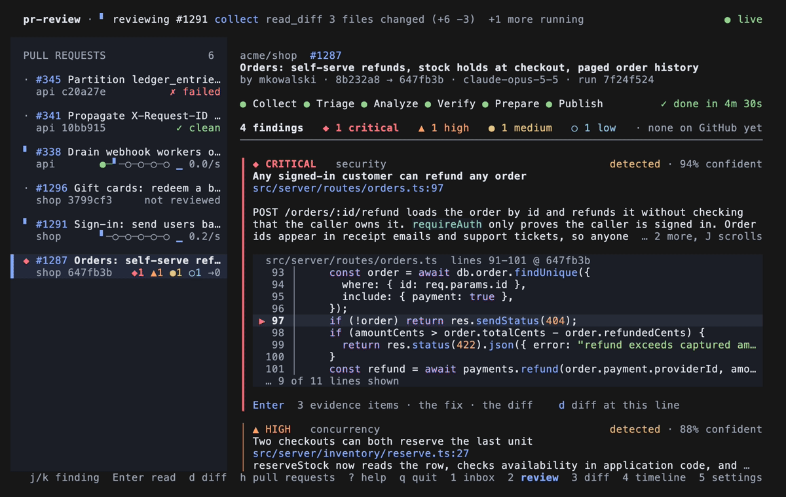

# pr-review

pr-review reviews GitHub pull requests and reports only findings it can back with evidence from the code. It tracks each PR across its commits, so a crash or restart resumes the review instead of starting over. Publishing is designed to post at most one review per commit, even when a write to GitHub times out or the process is killed partway through.

You can run it three ways:

- As a CLI that reviews one PR and prints the result, or posts it as a `COMMENT` review.
- As a GitHub App service that reviews PRs when webhooks arrive.
- From a terminal, `pr-review tui`, which opens on the most severe finding, shows each running review live, and puts every finding beside its code and its diff.

```text
$ node bin/pr-review.mjs review https://github.com/diego-arbio-dev/pr-reviewer/pull/2 --publish --model anthropic/claude-opus-5-5
model: anthropic/claude-opus-5-5 (--model)
revision d3defce78587d5d2fc4c3febae2da604 (diego-arbio-dev/pr-reviewer#2 @ 7683015c4b62) durable task 7
publication published: review 5586025680
## Automated PR review

Reviewed commit: `7683015c4b62b1b3ba765daa799368e4e073c52f`

Found 1 actionable issue.

- Critical: DELETE /orders/:id has no authentication or authorization (`src/routes/orders.js:16`)

Review performed with isolated read-only tools. Human review is still required.
```

## How a review works

Each review runs as a durable task with fixed phases: collect context, triage, analyze, verify, prepare, and publish. Every phase saves a checkpoint before the next one starts.

- **Triage.** Jev, a fast classifier, scores the risk of the change. It can raise the review depth above standard, never lower it. Path rules force a deeper review for areas such as auth, payments, and migrations.
- **Analyze.** A reasoning model reads the change through read-only tools: the diff, files and search at the pinned commit, and git history. It cannot write files, run commands, or post to GitHub.
- **Verify.** Code, not the model, checks every candidate finding. The finding must sit on a line in the diff, and its evidence must exist at the cited commit. Candidates that fail are discarded and their reasons recorded.
- **Publish.** The review goes through an outbox. pr-review checks GitHub for its own earlier review before posting. When a write's result is uncertain, it reconciles against GitHub instead of retrying blindly.

[`docs/SPEC.md`](docs/SPEC.md) is the full design.

## The terminal client



The client opens on the worst finding across the tracked PRs, and `w` follows a review while it runs. [The terminal client](docs/tui.md) covers its views, keys, and settings.

## Get started

You need Node 22.19 or later, pnpm, and git. The terminal client also needs a Rust toolchain.

To try the terminal client first, play the recorded showcase session. It needs no daemon, no credentials and no network:

```bash
(cd tui && cargo build --release) && ./tui/target/release/pr-review-tui --playback protocol/playback/showcase.ndjson
```

Press `?` for the keys and `q` to quit. To review your own PRs:

1. Install the dependencies:

	```bash
	pnpm install
	```

2. List the models you can use:

	```bash
	node bin/pr-review.mjs models
	```

	pr-review finds credentials in `~/.pi/agent/auth.json`, which it shares with the `pi` CLI, and in provider environment variables such as `ANTHROPIC_API_KEY`. If nothing is listed, run `node bin/pr-review.mjs login anthropic`.

3. Review a PR without posting anything:

	```bash
	node bin/pr-review.mjs review https://github.com/owner/repo/pull/123
	```

	Public repositories need no GitHub token. For private ones, pr-review uses `GITHUB_TOKEN`, or your `gh` login.

4. See every phase transition, the routing decision, and the discarded candidates:

	```bash
	node bin/pr-review.mjs inspect --pr owner/repo#123
	```

To post the review to the PR, add `--publish`. pr-review posts one `COMMENT` review with inline comments. It never approves, requests changes, or merges.

## Commands

| Command | What it does |
|---|---|
| `review <pr-url> [--dry-run \| --publish] [--json] [--model provider/id] [--no-jev] [--retry]` | Review one PR. Dry run is the default. Rerunning resumes an interrupted review or prints the stored result. |
| `inspect --pr owner/repo#N [--json]` | Show a PR's revisions, transitions, routing, findings, and discards. |
| `reconcile --revision <id>` | Decide an uncertain publication by listing the PR's reviews. Never posts. |
| `serve` | Run the webhook receiver, the worker, and the reviews in one process. |
| `models [--json]` | List the installed agent CLIs and the models you can use. |
| `login [provider] [--api-key]` | Store a model credential in pi's auth file. |
| `accounts [--json]` | List your `gh` accounts and show which one pr-review uses. |
| `accounts use <login>` | Use that `gh` account for GitHub reads and publishing in this data directory. |
| `approve --revision <id> --preview <hash>` | Publish a review that waits for approval (`publish_mode: "approval"`), exactly the stored payload, once. |
| `daemon [--socket PATH] [--data DIR] [--fixture NAME] [--allow-commands]` | Serve review state to the terminal client over a Unix socket, read-only by default; with `--allow-commands` it hosts the engine and runs the client's start, retry, cancel, and publish commands. |
| `tui [args]` | Start the terminal client, `pr-review-tui`. |

Run every command as `node bin/pr-review.mjs <command>`.

## Documentation

- [Configuration](docs/configuration.md) covers GitHub tokens and accounts, model choice, Jev, the config file, and where state lives.
- [Publishing](docs/publishing.md) explains how pr-review avoids posting a review twice, and how to recover an uncertain publication.
- [Running the service](docs/service.md) covers GitHub App setup, environment variables, endpoints, and deployment.
- [The terminal client](docs/tui.md) covers the daemon, the client's views, keys, mouse, and background setting, and the account selector.
- [Protocol v1](protocol/README.md) is the reference for the messages between the daemon and the TUI.
- [`docs/SPEC.md`](docs/SPEC.md) and [`docs/TUI_SPEC.md`](docs/TUI_SPEC.md) are the design specifications.

## Develop

```bash
pnpm typecheck && pnpm test             # TypeScript engine, daemon, and protocol
(cd tui && cargo test && cargo clippy --all-targets -- -D warnings && cargo fmt --check)
pnpm protocol:emit                      # regenerate protocol/schema, fixtures, and playback after changing src/protocol
```

The TypeScript code lives in `src/`, one directory per part of the system:

| Directory | Contents |
|---|---|
| `src/domain` | State machines for reviews, the outbox, the PR coordinator, candidates, and findings |
| `src/runtime` | The durable review task and the phases it runs |
| `src/reasoning` | The model's read-only tools, the candidate schema, and verification |
| `src/jev` | The Jev adapter and the routing policy |
| `src/source` | Git reads pinned by commit SHA |
| `src/github` | The GitHub client, PR reads, and `gh` account detection |
| `src/publish` | The review payload, posting, and reconciliation |
| `src/coordinator` | Webhook routing, debounce, leases, and superseding older revisions |
| `src/server` | HTTP endpoints and the service loop |
| `src/persistence` | The application SQLite store and its audit log |
| `src/models` | Model and harness detection, and the shared credential store |
| `src/protocol`, `src/control` | The TUI protocol and the control daemon |
| `src/cli` | The command-line interface |

The Rust terminal client is in `tui/`. Migrations are in `migrations/`. Commits follow [Conventional Commits](https://www.conventionalcommits.org/).

## Limits

- Verification is static. pr-review runs no tests against PR code, and no second model double-checks a finding.
- Each commit gets a fresh review. Tracking a finding across commits, marking it resolved, and replying in review threads are not built yet.
- The daemon accepts start, retry, cancel, and publish commands only when enabled, which is also when it takes the data directory itself.
- There is no labeled benchmark yet, so precision and recall are not measured.
