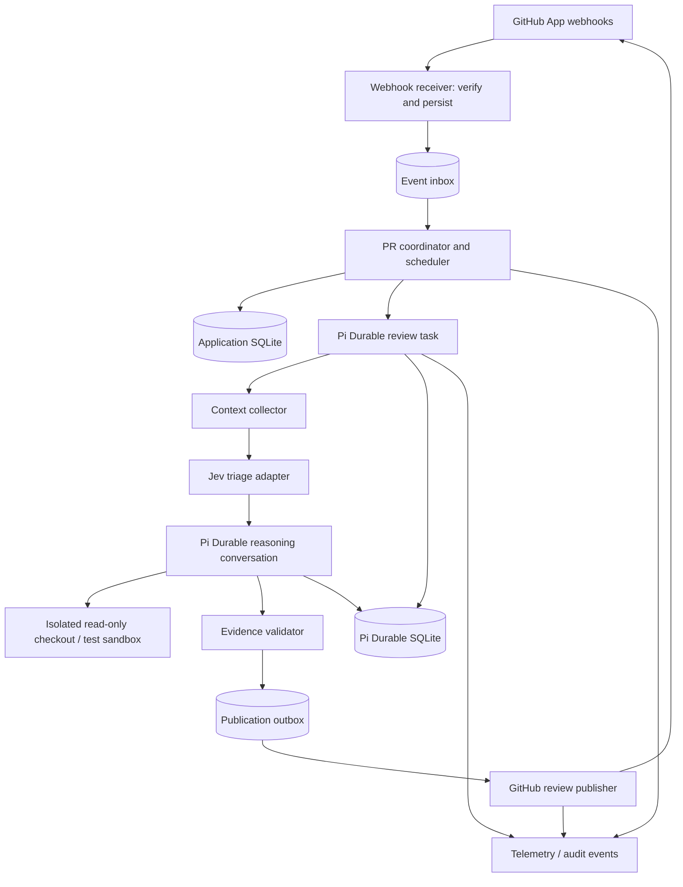
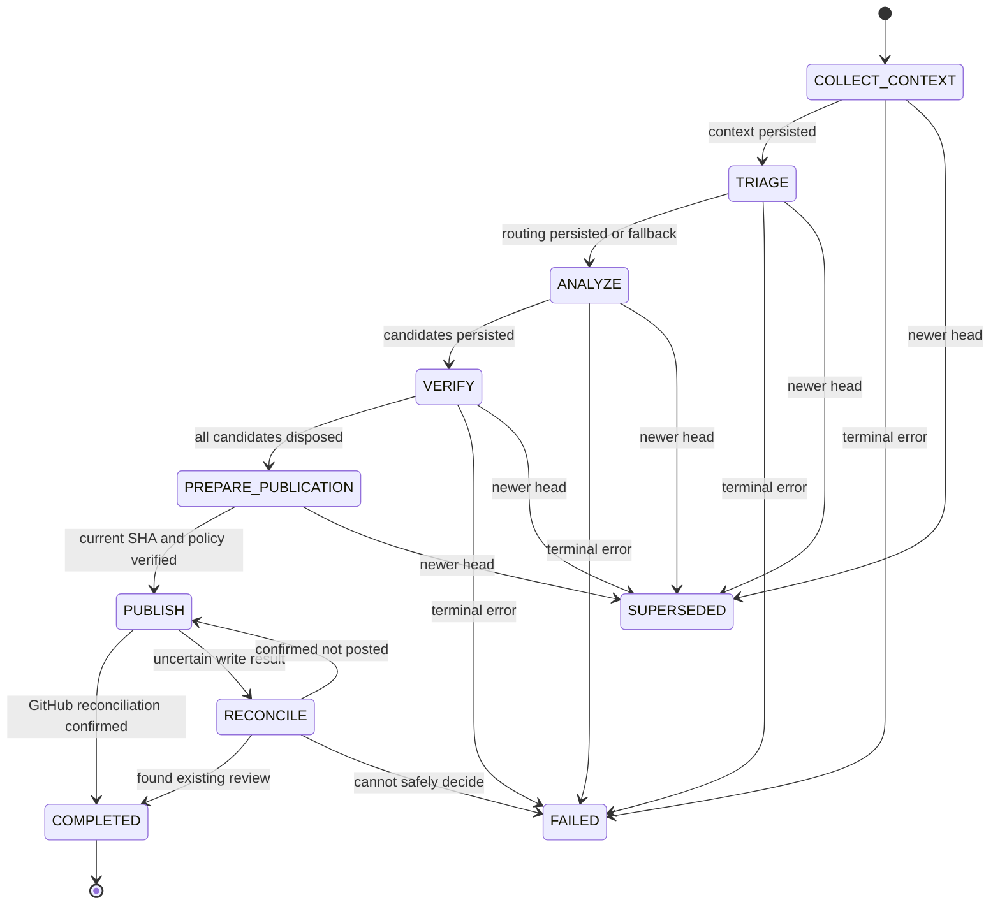

# Durable PR Review Agent — Technical Specification

**Status:** Implementation-ready proposal (v1.0)  
**Date:** 2026-10-20  
**Primary language:** TypeScript  
**Core architecture:** Pi Durable + hierarchical state machines + Jev + reasoning LLM + GitHub App  
**Release posture:** Read-only, advisory reviews; no merging, pushing, or repository mutations.

## 1. Executive summary

Build an autonomous PR reviewer that tracks the *evolution* of a pull request, rather than leaving a disposable review each time a commit is pushed. Each PR has a persistent identity, each head revision gets an immutable review run, and findings are tracked as first-class records across revisions. The reviewer gathers repository context, identifies defects, tries to verify them, publishes high-quality, actionable comments, and reassesses earlier findings on subsequent commits.

Three kinds of intelligence remain separate:

- **State machine:** deterministic lifecycle and legal transitions; never delegated to an LLM.
- **Jev:** fast, bounded, typed judgment for risk triage and specialist routing; advisory, with safe fallback.
- **Reasoning LLM:** exploratory code understanding, candidate generation, evidence gathering, and explanation.

**Pi Durable** provides persisted task checkpoints, agent conversations, tool execution and recovery. The application independently persists business records such as revisions, finding IDs, GitHub comment mappings, and publication outbox entries. Both must be recoverable after crashes.

### Goals

1. Identify actionable correctness, security, data integrity, concurrency and regression defects with supporting evidence.
2. Avoid low-value stylistic comments and duplicated findings.
3. Follow findings across commits; distinguish `resolved`, `still_present`, `outdated` and `uncertain`.
4. Survive process restarts without losing review progress or double-posting GitHub comments.
5. Reduce model spend using Jev-assisted prioritization without allowing low-confidence routing to hide high-impact changes.
6. Make every phase, decision and transition observable and testable.

### Non-goals (MVP)

- Automated merge or approval authority.
- Editing or pushing code to contributors' branches.
- Running arbitrary untrusted code on the host.
- A fleet of cooperating specialist agents.
- Guaranteeing detection of every possible bug.
- Using a model-generated numeric score as proof of correctness.

## 2. Architectural invariants

1. **PR identity:** `(installation_id, repository_id, pr_number)`; never key by mutable branch name alone.
2. **Revision identity:** `(pr_id, base_sha, head_sha, policy_version, reviewer_version)`; attempts are associated with this immutable key.
3. **One publishable review per revision/policy combination** (subject to a deliberate manual force-review override).
4. **Explicit application state is authoritative.** Conversation history is contextual evidence, not the database of findings.
5. **Never publish stale inline comments:** reread PR head SHA immediately before publication; if it has changed, mark the run superseded and reschedule.
6. **GitHub writes use an outbox and reconciliation.** A durable checkpoint alone cannot provide exactly-once delivery to an external API.
7. **Tools available to the review model are read-only by design**, with sandboxed test execution as a narrowly controlled exception.
8. **Jev cannot publish, approve, merge, cancel tasks or directly transition durable states.** It only returns structured judgments.
9. **No findings is a valid successful result.** Failure to run tools or collect context is not a clean review.
10. **Fail closed on authorization, sandbox isolation and publication uncertainty; fail open to deeper review on uncertain Jev risk triage.**

## 3. System architecture



### Logical components

| Component | Role |
|---|---|
| GitHub App | Scoped installation auth, webhook subscriptions, read PR files and reviews, write PR reviews. |
| Webhook receiver | Validate `X-Hub-Signature-256`, persist event, return 2xx promptly. |
| Coordinator | Deduplicate, coalesce pushes, maintain per-PR lease, schedule latest revision, handle terminal PR events. |
| Pi Durable harness | Checkpointed task phases, durable model/tool calls, recovery. |
| Jev adapter | Bounded `Choice`/`Score`/`Noul` classification; no workflow control. |
| Analysis agent | Searches relevant code and produces structured candidate defects. |
| Verification engine | Checks evidence, anchors lines, attempts targeted tests, rejects speculative claims. |
| Publisher | Writes review through a durable outbox; reconciles ambiguous GitHub responses. |
| Observability | Domain events, usage, review quality metrics and structured traces. |

**Deployment:** Single Node.js service and SQLite on persistent volume for MVP; one worker process handling jobs with per-PR leases. Separate webhook and workers only if required later. SQLite's durability settings should be explicitly selected and tested for intended crash/power-failure guarantees.

## 4. Hierarchical state machines

### 4.1 PR coordinator machine

States:
- `ACTIVE`: accepting new revisions and relevant discussions.
- `QUIESCING`: a new commit arrived; cancel or supersede an older in-flight attempt and debounce further pushes.
- `CLOSED`: PR closed without merge; no new review started.
- `MERGED`: PR merged; no new review started.

Events: `PR_OPENED`, `PR_REOPENED`, `PR_SYNCHRONIZED`, `REVIEW_REQUESTED`, `COMMENT_CREATED`, `PR_CLOSED`, `PR_MERGED`, `HEAD_CHANGED`, `FORCE_REVIEW`.

Coordinator rules:
- Only `ACTIVE` PRs accept new review runs.
- Latest-head wins for queued work; avoid spending tokens on an outdated queued revision.
- Never mutate an immutable revision key; create a new review run on new SHA.
- A new head may supersede active runs, but cleanup must not delete their durable audit records.
- Comments should trigger review only if directed at the bot or tied to a tracked finding; ignore bot-authored comments and prevent reply loops.
- Manual override is authorized, audited and never bypasses safety guards.

### 4.2 Per-revision review task machine



`FAILED` and `SUPERSEDED` are terminal for that immutable revision attempt. Transient error handling uses bounded retry/backoff within individual phases, without switching to `FAILED` on the first recoverable error. A no-findings review proceeds to completion via a summary or recorded silent result according to configured publication policy.

### 4.3 Candidate-finding submachine

`DISCOVERED → INVESTIGATING → (EVIDENCE_READY | INCONCLUSIVE | DISCARDED) → (VERIFIED | DISCARDED)`.

After publication, the persistent finding lifecycle is separate:
`PUBLISHED → STILL_PRESENT | POTENTIALLY_RESOLVED | OUTDATED → RESOLVED | STILL_PRESENT | UNCERTAIN`.

`POTENTIALLY_RESOLVED` is *not* equal to `RESOLVED`. Resolution requires a subsequent evaluation of code and evidence (not merely a changed line or Jev prediction).

### 4.4 Transition guards

| Transition | Deterministic guard |
|---|---|
| `COLLECT_CONTEXT → TRIAGE` | Commit metadata, changed-file manifests and repository policy are persisted. |
| `TRIAGE → ANALYZE` | Valid typed Jev response **or** safe fallback route stored. |
| `ANALYZE → VERIFY` | Model output parsed to candidate schema, including empty list. |
| `VERIFY → PREPARE_PUBLICATION` | Every candidate disposed; evidence references resolvable. |
| `PREPARE_PUBLICATION → PUBLISH` | Head SHA still matches; GitHub authorization intact; valid review anchor positions. |
| `PUBLISH → COMPLETED` | Review external ID reconciled and persisted, or configured intentional no-publication outcome recorded. |
| `ANY → SUPERSEDED` | Coordinator confirms newer head SHA or PR is no longer reviewable. |
| `ANY → FAILED` | Unrecoverable error or retry budget exceeded, with recorded reason. |

## 5. Pi Durable implementation strategy

Use `@earendil-works/pi-durable`, `@earendil-works/pi-ai` and `@earendil-works/chord` via the supported API **pinned to a tested release/commit** because Pi Durable is explicitly experimental. Use `defineTask` with `name`, `version`, `initial`, `phases`, `abort`, and `runtime.commit` for phase checkpoints. Use SQLite-backed harness storage from `@earendil-works/pi-durable/storage/sqlite/node`.

### Durable state shape

```ts
type ReviewCheckpoint =
  | { phase: 'collect'; revisionId: string }
  | { phase: 'triage'; revisionId: string; contextSnapshotId: string }
  | { phase: 'analyze'; revisionId: string; triageDecisionId: string }
  | { phase: 'verify'; revisionId: string; candidateSetId: string }
  | { phase: 'prepare'; revisionId: string; verifiedSetId: string }
  | { phase: 'publish'; revisionId: string; outboxId: string }
  | { phase: 'reconcile'; revisionId: string; outboxId: string };
```

Keep checkpoint payloads small and reference persisted immutable snapshots by ID. Large diffs, full context and tool outputs belong in repository-backed storage, not copied repeatedly into each checkpoint.

### Recommended implementation conventions

- Create a durable task per review revision, owned by a designated conversation or coordinator task.
- A persistent PR-level conversation may summarize previous revisions; prefer compact structured summaries to replaying all historical tokens.
- Use a frozen context snapshot for the revision and stable request IDs for agent submissions.
- Use the harness extension registry to expose only approved tools to the review agent. Do **not** install the full default coding tool bundle if it provides write/edit/bash access.
- Declare `replay: 'safe'` only for truly replay-safe tools; treat arbitrary tests and all external writes as non-replay-safe unless guarded by idempotent orchestration.
- Use durable memoization for internal steps only where it has correct semantics; never rely on memos alone for GitHub exactly-once publication.
- Support version migration for checkpoint schema changes; require explicit handling when a deployed task version differs from a persisted task.

**API reference (verify during implementation):**
- https://github.com/earendil-works/pi/blob/main/packages/durable/README.md
- https://github.com/earendil-works/pi/blob/main/packages/durable/test/examples/13-recovery.ts

## 6. Jev decision engine

Jev is a **cost/attention router**, not a defect oracle. Implement as `DecisionEngine` with a provider-specific adapter. For TypeScript, evaluate `jev-systemone` and `open-jev`; choose one pinned implementation after testing provider compatibility, response structure and latency. Both expose the Jev primitives `Choice`, `Score`, and `Noul`, although their precise SDK response types differ. Avoid coding against an assumed universal Jev API.

### 6.1 Decision contracts

```ts
type Category = 'security' | 'concurrency' | 'correctness' |
  'data_integrity' | 'performance' | 'general' | 'other';

type TriageResult = {
  primaryCategory: Category;
  categoryProbabilities: Partial<Record<Category, number>>;
  riskScore: number; // normalize provider rubric into [0,1] explicitly
  riskDistribution?: number[];
  routingConfidence: number | null;
  needsDeepReviewProbability: number;
  selectedReviewMode: 'standard' | 'deep' | 'critical';
  adapterVersion: string;
  modelId: string;
};

interface DecisionEngine {
  triage(input: TriageInput): Promise<TriageResult>;
  classifyRevision(input: RevisionDelta): Promise<{
    relationship: 'possibly_fixed' | 'still_relevant' | 'unrelated' | 'uncertain';
    confidence: number | null;
  }>;
}
```

Jev question recommendations:
- **Choice:** Dominant risk category, with explicit `other`.
- **Score:** Impact/review-risk rubric with concrete ordered descriptions, not vague labels.
- **Noul:** “Does this change involve trust boundaries / permissions / persisted data / concurrent mutation?” Provide precise true/false criteria.

Jev outputs are distributions or probabilities. An individual score is not evidence of a bug. Never interpret Noul `0.5` as “medium severity”; it means uncertainty. Score ranges and confidence definitions differ by SDK, so normalize in the adapter and retain raw responses for analysis.

### 6.2 Triage policy

Deterministic rules take precedence over Jev:

- Always select `critical` or mandatory deep checks for paths matching configured authentication, authorization, crypto, secret handling, payment, financial, booking-inventory, migration or privacy-sensitive areas.
- Never skip baseline static checks and standard changed-file review based solely on a low Jev risk score.
- If Jev times out, errors, returns low confidence or an invalid schema: use `standard` review, upgraded by deterministic path rules.
- Triage only affects **budget and specialist prompt focus**; it cannot suppress all review for an otherwise reviewable PR.
- Record `decision_input_hash`, provider, model ID, raw distributions, normalized values, thresholds and selected route for debugging.

### 6.3 Modes

| Mode | Typical checks | Initial resource policy (tunable) |
|---|---|---|
| Standard | Diff, call-site inspection, basic static checks, focused tests where relevant | 1 analysis conversation, bounded exploration |
| Deep | Trace affected invariants and relevant dependencies, more verification | Larger token/tool budget |
| Critical | Mandatory policy checks, deep code inspection, explicit human escalation | Larger budget, no automated approval |

Avoid hardcoded Jev confidence thresholds until a labeled evaluation corpus is available. Make thresholds config-backed and calibrate on actual PRs. Compare Jev routing to a baseline without Jev and report missed high-severity cases.

## 7. Reasoning agent

### Inputs

- PR title/description and linked issue context (treated as untrusted text).
- Repository rules (`AGENTS.md`, approved review policy, code ownership), distinguishing trusted operator config from untrusted repository content.
- Base/head SHAs, changed files, patch hunks, status, tests and build metadata.
- Previous persisted finding summaries and developer replies relevant to this revision.
- Jev routing hints and applicable mandatory policy checks.

### Tools

- `read_file(path, ref)`: read within a pinned checkout, enforce path boundaries.
- `search_code(query, scope)`: ripgrep/index-backed search with bounded results.
- `read_diff(file)` / `get_changed_files()`: Git diff for pinned revision.
- `git_history(path, limit)`: bounded history for reasoning about intent.
- `inspect_test_manifest()` and `run_targeted_tests(commandId)`: only preapproved commands in a sandbox.
- `previous_findings()` / `get_finding(id)`: structured review history.

No general `write`, `edit`, unrestricted `bash`, secret reading, shell network access or GitHub publish tool is exposed to the model. If test execution is enabled, use an ephemeral container with non-root user, limited CPU/memory/time, disabled outbound network by default, no GitHub credentials, no privileged mounts and read-only source with a disposable writable overlay.

### Candidate schema

```ts
type CandidateFinding = {
  id: string;
  category: Category;
  severity: 'critical' | 'high' | 'medium' | 'low';
  title: string;
  explanation: string;
  file: string;
  newLine: number | null;
  codeEvidence: Array<{ path: string; start: number; end: number; refSha: string }>;
  reasoningSummary: string;
  suggestedFix?: string;
  confidence: number; // model estimate, never standalone publish guard
};
```

Use `candidate → verify → disposition`. A candidate must cite a plausible broken invariant or user-visible incorrect behavior. Prefer no comment over unsubstantiated speculation; don't publish formatting preferences unless mandated by policy.

### Verification

- Verify changed line anchors still exist in the target head revision.
- Trace the executable path or identify deterministic violation with enough context.
- Run focused tests only when safe and useful; a static proof may be sufficient.
- Mark evidence as `confirmed_by_test`, `confirmed_by_static_trace`, `suspected`, or `unreproducible`.
- Publish only `verified` findings with reproducible justification under configured severity/confidence policy.
- Deduplicate findings semantically and by stable fingerprint derived from defect type + code location + violated invariant; don't key solely by line number.
- Treat tests run against attacker-controlled PR code as untrusted; never interpret emitted test logs as privileged instructions.

## 8. Persistence schema

Use application SQLite in addition to Pi Durable storage. They may share a deployment volume but must maintain clear ownership and explicit migration boundaries. Tables:

```sql
CREATE TABLE pull_requests (
  id TEXT PRIMARY KEY,
  installation_id INTEGER NOT NULL,
  repository_id INTEGER NOT NULL,
  number INTEGER NOT NULL,
  status TEXT NOT NULL,
  latest_base_sha TEXT NOT NULL,
  latest_head_sha TEXT NOT NULL,
  updated_at TEXT NOT NULL,
  UNIQUE (installation_id, repository_id, number)
);

CREATE TABLE review_revisions (
  id TEXT PRIMARY KEY,
  pr_id TEXT NOT NULL REFERENCES pull_requests(id),
  base_sha TEXT NOT NULL,
  head_sha TEXT NOT NULL,
  policy_version TEXT NOT NULL,
  reviewer_version TEXT NOT NULL,
  state TEXT NOT NULL,
  durable_task_id TEXT,
  created_at TEXT NOT NULL,
  completed_at TEXT,
  UNIQUE (pr_id, base_sha, head_sha, policy_version, reviewer_version)
);

CREATE TABLE findings (
  id TEXT PRIMARY KEY,
  pr_id TEXT NOT NULL REFERENCES pull_requests(id),
  first_revision_id TEXT NOT NULL REFERENCES review_revisions(id),
  fingerprint TEXT NOT NULL,
  status TEXT NOT NULL,
  current_severity TEXT NOT NULL,
  github_thread_id TEXT,
  created_at TEXT NOT NULL,
  updated_at TEXT NOT NULL
);

CREATE TABLE finding_observations (
  id TEXT PRIMARY KEY,
  finding_id TEXT NOT NULL REFERENCES findings(id),
  revision_id TEXT NOT NULL REFERENCES review_revisions(id),
  disposition TEXT NOT NULL,
  evidence_json TEXT NOT NULL,
  location_json TEXT NOT NULL,
  created_at TEXT NOT NULL,
  UNIQUE (finding_id, revision_id)
);

CREATE TABLE webhook_events (
  delivery_id TEXT PRIMARY KEY,
  event_type TEXT NOT NULL,
  payload_hash TEXT NOT NULL,
  processed_at TEXT,
  received_at TEXT NOT NULL
);

CREATE TABLE publication_outbox (
  id TEXT PRIMARY KEY,
  revision_id TEXT NOT NULL REFERENCES review_revisions(id),
  idempotency_key TEXT NOT NULL UNIQUE,
  payload_hash TEXT NOT NULL,
  payload_json TEXT NOT NULL,
  status TEXT NOT NULL,
  github_review_id INTEGER,
  attempt_count INTEGER NOT NULL DEFAULT 0,
  updated_at TEXT NOT NULL
);
```

Add `review_attempts`, `decision_records`, `context_snapshots`, `audit_events`, `leases` and `usage_records` as needed. Application-controlled IDs should be stable across retries.

## 9. GitHub integration

### 9.1 App permissions

Start with minimum required permissions: metadata read, pull requests read/write for review comments, contents read. Add checks/status permissions only if you explicitly publish checks. Subscribe to PR lifecycle webhooks and targeted review/comment events. Validate current GitHub App permission/event requirements against official docs before app registration.

### 9.2 Ingestion

1. Receive webhook, verify HMAC signature with constant-time comparison.
2. Persist immutable delivery ID and payload digest in the event inbox.
3. Respond quickly, processing asynchronously in the same running worker (with durable queue persistence).
4. Ignore unsupported, duplicate and bot-generated events.
5. Fetch authoritative current PR state from GitHub; never trust event order.
6. Acquire per-PR lease and schedule/coalesce review for latest base/head pair.

### 9.3 Publishing with reconciliation

GitHub's REST API supports PR reviews with inline comments and commit association. It does **not** offer universal exactly-once transactional semantics. Build an outbox:

1. Persist a canonical payload and `idempotency_key = review_revision_id + publisher_version`.
2. Re-check current PR head and ensure each inline anchor maps to the current diff.
3. Add a stable marker to review body such as `<!-- durable-review:revision-id:payload-hash -->`.
4. Submit one batched review (default `COMMENT`, never `APPROVE` or `REQUEST_CHANGES` without explicit product policy).
5. Save returned GitHub review ID.
6. If network response is ambiguous, list existing reviews, look for the marker, compare author/commit/payload and reconcile before any retry.
7. If absence cannot be established reliably, leave outbox `needs_reconciliation`; never blindly double-submit.

For previous findings, GitHub review thread resolution is a separate capability requiring suitable API support/permissions. MVP can update finding state in its own database and publish a concise follow-up summary rather than claiming to have resolved a GitHub thread. Do not invent review-thread APIs.

### 9.4 Rate limits and retries

Respect GitHub primary and secondary rate limits, use bounded exponential backoff/jitter for transient errors, cap concurrency per installation, and preserve pending work during outage/restart. Make retry counts, maximum review duration and total model spend configurable.

## 10. Security and trust boundaries

- GitHub webhook payload authenticity verification is mandatory.
- Repository files, PR descriptions, code comments, issues and test output are **untrusted data**, not developer/system instructions.
- No privileged tools or tokens inside the clone/test sandbox.
- Avoid exposing full secrets from environment, checked-in fixtures or logs to LLM providers; implement redaction and content limits.
- Reject traversal and symlink escapes when reading files.
- Restrict repository operations to exact authorized GitHub installation scope.
- Restrict tests to allowlisted scripts; enforce CPU/time/memory/storage caps and network egress restrictions.
- Audit all GitHub writes, manual overrides, state transitions and privileged operations.
- Establish retention policy for PR source snippets, model transcripts and tool outputs.
- Never let a PR contain instructions that override the review policy.

## 11. Operational behavior

### Superseded runs

When PR head changes, mark older revision's application status `superseded_requested`, cancel/wind down the durable task where possible, and prohibit publication at the final guard. Newest revision gets scheduled. Historical candidate findings remain for traceability; their status must be reevaluated on the new head.

### Recovery

On process restart:
1. Reopen Pi Durable SQLite storage and registry pinned to compatible task versions.
2. Resume/wait for unfinished durable tasks.
3. Scan application `review_revisions` and `publication_outbox` for unfinished work.
4. Reconcile GitHub publication before retrying external writes.
5. Reacquire expired per-PR leases safely.
6. Verify duplicate webhook deliveries do not create duplicate tasks.

### Cancellation

Cancellation is best-effort during an active model/tool call; terminal checkpoints and publication head guards ensure stale work cannot publish even if cancellation races with an in-flight operation.

### Costs and tracing

Record: phase latencies, Jev inputs/results and usage, reasoning-model token/cost use, tools invoked, test runtime, retry/recovery counts, reviewer version, comments published, findings later resolved/dismissed, and user feedback. Never log access tokens or raw confidential repository content by default.

## 12. Public interfaces

CLI:

```bash
pr-review review https://github.com/owner/repo/pull/123 --dry-run
pr-review review https://github.com/owner/repo/pull/123 --publish
pr-review inspect --pr owner/repo#123
pr-review replay --revision <revision-id> --dry-run
pr-review reconcile --revision <revision-id>
```

Server endpoints (internal/authenticated, except verified webhook):

- `POST /webhooks/github` — event ingest.
- `GET /healthz` — process health.
- `GET /readyz` — DB, worker and storage readiness.
- `GET /reviews/:revisionId` — inspection, including events and findings.
- `POST /reviews/:revisionId/retry` — authorized override, audited.

Review summary format:

```markdown
## Automated PR review

Reviewed commit: `<head sha>`

Found 2 actionable issues; 1 previous issue appears resolved.

- High: Possible oversubscription under concurrent booking requests.
- Medium: Missing authorization on the new endpoint.

Review performed with isolated read-only tools. Human review is still required.
```

For zero findings, report: `No actionable issues found in the reviewed scope` (never “This PR is bug-free”).

## 13. Repository layout

```text
pr-review-agent/
├── apps/
│   ├── cli/
│   └── server/
├── packages/
│   ├── domain/               # Entities, invariants, state machines
│   ├── coordinator/          # Webhook queue, leases, revision scheduling
│   ├── pi-runtime/           # Pi Durable harness, tasks, registry, extensions
│   ├── jev-decisions/        # DecisionEngine + implementation adapter
│   ├── reasoning/            # Agent prompts, candidate schema, validation
│   ├── github/               # Octokit, webhooks, reviews, reconciliation
│   ├── sandbox/              # Checkout, test runner, execution policy
│   ├── persistence/          # SQL migrations, repositories, outbox
│   ├── telemetry/            # Domain events, traces, cost reporting
│   └── config/               # Policy, budgets, path-based gates
├── prompts/
│   ├── reviewer.md
│   ├── verify-finding.md
│   └── reconcile-finding.md
├── tests/
│   ├── fixtures/             # Seed PRs with known defects and fixes
│   ├── domain/
│   ├── integration/
│   ├── crash-recovery/
│   └── evals/
├── docker/
├── migrations/
├── .env.example
└── README.md
```

## 14. Implementation milestones

### M1 — Local durable reviewer

- [ ] CLI accepts PR URL and checks authorization.
- [ ] Pi Durable task uses explicit phase checkpoints and SQLite.
- [ ] Collect pinned PR diff/context; review in a sandboxed environment.
- [ ] Jev adapter + deterministic fallback produces typed triage.
- [ ] Reasoning agent generates structured candidates, verification filters them.
- [ ] Dry-run Markdown/JSON output only; no GitHub writes.
- [ ] Kill/restart mid-`ANALYZE` and verify useful state recovery.

**Acceptance:** Given a known-defect test PR, produce a reproducible finding and correct diff anchor; restart does not corrupt task state or duplicate candidates.

### M2 — GitHub automation

- [ ] Installable GitHub App, signature-verified webhook receiver.
- [ ] Dedup and coalesce webhook events; latest-head scheduling.
- [ ] Outbox-backed publisher with commit-SHA guard and review marker.
- [ ] Crash tests at every point of publication, including ambiguous responses.
- [ ] Rate-limit-aware retries; deployment and migrations.

**Acceptance:** Duplicate webhooks and simulated publisher crashes cause at most one published review per revision, or transition safely to manual reconciliation without duplicate writes.

### M3 — Continuous context and re-review

- [ ] Persist finding identity across revisions.
- [ ] Classify candidate fixes with Jev, then independently verify.
- [ ] Reply to relevant review conversations without bot loops.
- [ ] Mark findings as resolved/still-present/uncertain/outdated with evidence.
- [ ] Expose revision history and inspect command.

**Acceptance:** Fixture with `bug introduced → bot reports → partial fix → complete fix` produces correct state progression and no repeated duplicate comment.

### M4 — Quality and efficiency

- [ ] Build labeled PR benchmark including clean PRs and severe defects.
- [ ] Compare Jev routing against no-Jev baseline.
- [ ] Add cost/latency/false-positive metrics and evaluation dashboard.
- [ ] Tune risk thresholds and investigation budgets based on results.
- [ ] Consider repository-specific policies and optional specialist conversations.

**Acceptance:** Demonstrate measurable efficiency gain without an unacceptable regression in high-severity recall. Do not predeclare a percentage before collecting baseline data.

## 15. Testing strategy

### Pure state-machine tests

- Legal/illegal transition matrix.
- All event ordering permutations relevant to `opened`, `synchronize`, `closed`, `reopened`.
- State-machine invariants (property-based testing recommended).
- Timeout, cancellation and terminal-state behavior.

### Durability/fault-injection tests

Crash after each checkpoint, before/after Jev responses, during inference, during tool execution, before GitHub post, after GitHub post but before response/DB commit. Assert deterministic recovery or safe reconciliation, no stale publication and no leaked lease.

### Security tests

Webhook forged signature, path traversal, malicious symlink, malicious `AGENTS.md`, instruction injected in diff, attempts to call unavailable tools, sandbox network escape, dangerous npm scripts, token leakage.

### Review-quality evals

At minimum: auth bypass, race in inventory reservation, faulty transaction boundary, accidental N+1 issue, data loss migration, benign refactor, cosmetic-only change, test-only change, partial fix, and false-positive trap. Human-label expected outcomes.

Metrics:

- **Precision:** accepted/reproducible findings ÷ all published findings.
- **High-severity recall:** caught labeled serious defects ÷ serious defects in benchmark.
- **Duplicate rate:** duplicate comments / all comments.
- **Resolution accuracy:** correctly classified resolved/still-present observations / evaluated observations.
- **Cost:** model spend per PR and per verified finding.
- **Latency:** webhook to completed review, by PR size and risk mode.
- **Jev routing miss rate:** serious-defect examples incorrectly routed low, regardless of whether baseline review caught them.

## 16. Configuration

```yaml
review:
  publish_mode: comment # alternatives: dry_run, silent_no_findings
  require_human_review: true
  on_jev_failure: standard
  max_retries_per_phase: 3
  max_changed_files: 300
  max_diff_bytes: 2000000
  max_review_cost_usd: 5.0 # initial operator-configured safeguard, not a cost prediction
  debounce_seconds: 30
  base_policy_version: '1'

routing:
  mandatory_deep_paths:
    - '**/auth/**'
    - '**/payments/**'
    - '**/booking/**'
    - '**/migrations/**'
  fallback_mode: standard
  # Jev thresholds only after calibration.

sandbox:
  network: disabled
  privilege: unprivileged
  write_repo: false
  max_cpu: 2
  max_memory_mb: 4096
  max_runtime_seconds: 120

publication:
  event: COMMENT
  reject_outdated_head: true
  reconcile_before_retry: true
```

Operational note: `max_changed_files` / `max_diff_bytes` are alert/escalation thresholds, **not a reason to claim a complete review**. Oversize PRs must be chunked, scoped with an explicit limitation, or escalated.

## 17. Open decisions

1. **Jev SDK:** `jev-systemone` vs `open-jev`, based on provider and server-runtime compatibility; pin a tested version.
2. **Sandbox runtime:** Docker/Podman vs dedicated microVM; Docker is suitable for initial trusted/internal evaluation but harden further before reviewing arbitrary untrusted public contributors.
3. **Review history presentation:** initial GitHub review summaries vs an eventual web UI for finding timelines.
4. **Policy source:** trusted operator configuration vs repository-defined rules and precedence.
5. **LLM/provider selection:** configurable model per risk tier; benchmark quality, latency and cost.
6. **Thread resolution:** determine exact GitHub integration semantics before enabling automatic thread resolution.
7. **PR comment triggers:** limit to explicit mentions in MVP to avoid accidental agent ping-pong.

## 18. Implementation order / first coding session

1. Initialize pnpm monorepo, TypeScript strict mode, Vitest, linting and SQLite migrations.
2. Implement domain machines as pure transition functions with exhaustive tests.
3. Add PR/revision/finding repositories and stable revision IDs.
4. Implement CLI `review <url> --dry-run` and GitHub read adapter.
5. Pin Pi Durable release and implement a two-phase demo task with actual restart test, then expand phases.
6. Implement mock `DecisionEngine`, then real Jev adapter; preserve raw distributions.
7. Add reasoning harness with strictly read-only tools and candidate schema validation.
8. Implement verification and evidence anchoring.
9. Build labeled fixtures and compare against manual expectations.
10. Only then add GitHub write integration, outbox and crash fault injection.

### Definition of done for MVP

A user can run `pr-review review <pr-url> --dry-run`, observe a durable review execution, obtain zero or more evidence-backed findings, kill and restart the process without corrupting progress, inspect all phase transitions, and reproduce findings from pinned revision data. The model cannot modify source or publish comments. Jev may optimize focus but cannot suppress mandatory checks or override state transitions.

## References

- Pi Durable README: https://github.com/earendil-works/pi/blob/main/packages/durable/README.md
- Pi Durable restart/recovery example: https://github.com/earendil-works/pi/blob/main/packages/durable/test/examples/13-recovery.ts
- Jev System One TypeScript client: https://github.com/SC0d3r/jev-systemone
- Open Jev TypeScript: https://github.com/nico-martin/open-jev
- GitHub REST API pull request reviews: https://docs.github.com/en/rest/pulls/reviews
- GitHub webhook validation: https://docs.github.com/en/webhooks/using-webhooks/validating-webhook-deliveries

---

**Guiding principle:** *Durable execution, deterministic control, probabilistic prioritization, evidence-based review.*
