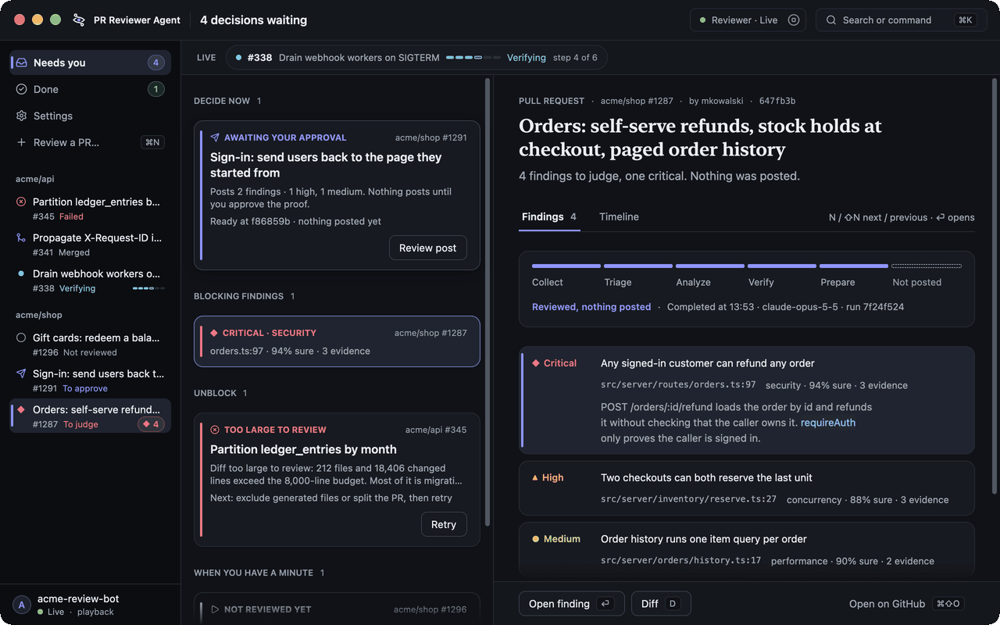

# pr-review-desktop

PR Reviewer Agent (`pr-review-desktop`) is a macOS client for pr-review, built on [GPUI](https://www.gpui.rs) through [gpui-kit](https://crates.io/crates/gpui-kit) 0.8.0. The window is a triage inbox: a queue of the decisions waiting on you, each with its detail beside it, a live strip of running reviews, every PR in the sidebar, the diff with findings anchored, a timeline, and a command palette (⌘K). [DESIGN.md](DESIGN.md) describes the design and its tokens.

The app links the terminal client in `../tui` as a library and runs its reducer, `update(&mut Model, Msg) -> Vec<Effect>`, and its network task unchanged. The protocol rules, the key guards and the playback all come from there. The terminal client stays as it is.



`demo.sh` records this GIF from the showcase playback, with no daemon or network: `desktop/demo.sh` from the repository root.

## Build and run

The build needs Rust and macOS. It does not need Xcode.

```bash
cd desktop
cargo build --release
./target/release/pr-review-desktop --socket /tmp/pr-review/reviewer.sock
```

The app takes the terminal client's flags: `--socket PATH`, `--pr URL`, `--playback FILE.ndjson` and `--config FILE`. With no `--socket` it uses the socket from the config file, then the platform default. `--help` lists every flag.

To run it against a daemon that serves the showcase fixture:

```bash
mkdir -m 700 /tmp/prd
node bin/pr-review.mjs daemon --fixture showcase --socket /tmp/prd/s.sock    # terminal 1, from the repository root
desktop/target/release/pr-review-desktop --socket /tmp/prd/s.sock            # terminal 2
```

Keep the socket path short. macOS refuses a socket path longer than 103 bytes, and the daemon refuses a socket directory that is a symlink, such as `/tmp` itself.

### The title bar

The title bar shows the app's mark and name, "PR Reviewer Agent", then the page title. On the right, the reviewer pill always shows the reviewer's state ("Reviewer · Live", "Offline", "Stopped by you", "Starting…") with the one action that changes it: Stop while the daemon answers, Start while it doesn't. A start or stop under way shows a spinner, and an action that can't run is dimmed with the reason in its tooltip. Restart is in the **Reviewer** menu and the palette.

### Review a new PR

Against a daemon started with `--allow-commands`, press ⌘N, or choose **Review a PR…** in the sidebar, the palette or the empty state. Paste the PR's URL (⌘V), or type `owner/repo#N`. The sheet shows the repository and number it read, and ⏎ asks the daemon to add it. The daemon reads the PR from GitHub with its own account and starts its review; the sheet closes on the new PR. If the daemon refuses, the sheet says why in place: a PR its account can't see, a closed or merged PR, or text that isn't a PR link. A PR the window already tracks opens instead. On a read-only daemon the entries are locked with the reason.

With the reviewer stopped or offline, ⌘N still opens the sheet when the app can start the reviewer: ⏎ starts it, the sheet reads "Starting the reviewer, then adding …", and the PR is sent once the daemon answers. A start that fails says why in the sheet.

### Archive a PR

Press E on a PR's page, or choose **Archive** on its action bar or in the palette. The PR leaves Needs you, Done, the sidebar's repository lists and the live strip, and the next PR opens. **Archived** in the sidebar, **View → Archived** or ⌘3 lists the archived PRs; each row has **Unarchive**, and E on an archived PR's page unarchives it. A review running on the PR goes on, and starting a review on it brings it back. The daemon keeps the archive, so it survives a restart and every client sees it, and a read-only daemon allows it too.

### Usage

**Usage** in the sidebar, **View → Usage**, the palette or ⌘4 shows what reviews cost. Day, Week and Month (D, W, M) group the last 14 days, 12 weeks (Monday first) or 12 months in the reviewer's time zone. The page shows the range's estimated cost, a column chart of cost per day, week or month with its axis in USD (hover a column for its numbers), a table of each period's reviews and input, output, cache read and cache write tokens and cost with the range's totals, and the split by model. Over time, Repository, Author and PR (T, R, A, P) split the same range: a bar per repository, PR author or PR for the costliest ten, the rest summed as Other, each with its cost and share, then a table of every row with its reviews, tokens, cost and share. Click a PR's row, or press ⏎ on it, to open that PR. A PR whose author the reviewer has not read yet is under Unknown author until its next read from GitHub. Costs are the model's list price from pi-ai's catalog, so a subscription login is billed differently. The daemon records usage from this version on, so reviews before it are not counted. The page asks the daemon again when it opens, on ⌘R, and whenever a review ends. Esc or ⌘[ leaves it.

### Start and stop the reviewer

When nothing answers on the socket, the offline screen's primary action is **Start reviewer** (⌘R). The **Reviewer** menu, the palette and the Reviewer card in Settings also offer **Stop reviewer** and **Restart reviewer**. The card shows the state, the socket, the mode, how the daemon runs on this machine and where its log is. On a read-only daemon, stop and restart are off with the reason, because that daemon may belong to another process.

The app starts the daemon in one of two ways:

1. **Its LaunchAgent.** If `~/Library/LaunchAgents/<label>.plist` exists and serves the socket this window dials (its `--socket` argument, or the default socket when it has none), the app runs `launchctl kickstart gui/<uid>/<label>` when the job is loaded, and `launchctl bootstrap gui/<uid> <plist>` when it is not. The label is `io.github.diego-arbio-dev.pr-review.daemon` by default.
2. **A process it spawns.** Otherwise the app runs `pr-review daemon --allow-commands --socket <socket>` in its own process group, so it outlives the app, with stdout and stderr appended to `~/Library/Logs/pr-review/daemon.log`. It runs `daemon_command` from the config file when that is set, else `pr-review` from the app's `PATH`. An app opened from Finder gets a short `PATH`, so set `daemon_command` there. With neither, the start says what to set.

Both live in the `[desktop]` section of the config file the app reads (`--config`, default `~/Library/Application Support/pr-review/config.toml`). The terminal client parses the section and ignores it.

```toml
[desktop]
# Shell syntax; the app appends daemon --allow-commands --socket <socket>.
daemon_command = "node /path/to/pr-reviewer/bin/pr-review.mjs"
# The LaunchAgent the app starts and stops through launchctl.
launch_agent = "io.github.diego-arbio-dev.pr-review.daemon"
# The theme Settings saves: system, light, dark, solarized-light, solarized-dark or nord.
theme = "nord"
```

The window shows "Starting the reviewer" and dials as soon as the socket appears. After 20 s without a welcome, the start counts as failed, and the window says why and where the log is.

Stop sends the protocol's `daemon.stop`. The daemon answers, then shuts down as on SIGTERM: running reviews pause and resume on the next start, the data-dir lock is released, the socket is removed and the process exits 0. While a review runs, the app asks first. The window then reads "Reviewer stopped", which is not the same as offline. Restart is a stop, then a start.

A LaunchAgent with `KeepAlive` set to `true` is restarted by launchd after any exit, a clean one included. The app reads the plist's `KeepAlive` on every ask. When it is `true`, Stop opens a sheet that says so and offers **Stop and keep stopped**, which runs `launchctl bootout gui/<uid>/<label>`. launchd then stops the daemon with SIGTERM and unloads the job, and the next Start bootstraps it again. The recommended setting keeps the job loaded and lets a clean exit stay stopped, while launchd still restarts a crash:

```xml
<key>KeepAlive</key>
<dict>
  <key>SuccessfulExit</key>
  <false/>
</dict>
```

With that setting, Stop is a plain `daemon.stop` and Start is a `launchctl kickstart`.

### Settings

⌘, opens Settings: Appearance (see [Themes](#themes)), the daemon's setup checks, two sections that change how it reviews, the reviewer, and the GitHub accounts.

- **Risk check (Jev)** saves your TypeSafe key in the login keychain, where the daemon reads it for the next review with no restart. The field is masked and the page says only whether a key is saved. Off macOS, set `TYPESAFE_API_KEY` in the daemon's environment instead. [Configuration](../docs/configuration.md#typesafe-key-in-the-macos-keychain) explains how the key is kept.
- **Agent** lists the models the daemon can review with, grouped by provider and searchable, with the one in use and where each provider's credential comes from. Save makes the choice the daemon's `models.default`. Reviews started from then on use it, and a PR reviewed again with another model gets a new revision.

### Themes

**Settings** (⌘,) opens on **Appearance**, with a tile for each theme: **System**, which follows macOS between Light and Dark and is the default, **Light**, **Dark**, **Solarized Light**, **Solarized Dark** and **Nord**. **View → Appearance** and the palette (type `theme`) offer the same list. A theme applies at once. The app saves it as `theme` in the `[desktop]` section of its config file, the one `--config` names, else `~/Library/Application Support/pr-review/config.toml`, and opens in it on the next launch. The app changes only that line and leaves the file's other keys and comments as they are. When the file holds `[desktop]` as an inline table it can't edit that way, the app says so in a toast and saves nothing. An unknown `theme` falls back to System with a warning on stderr. The terminal client's own `[ui] theme` is separate.

The Solarized and Nord palettes keep their canonical colors where those pass the app's contrast test, and move the others in lightness only. [DESIGN.md](DESIGN.md#themes) lists each change.

To play a scripted session with no daemon:

```bash
desktop/target/release/pr-review-desktop --playback protocol/playback/showcase.ndjson
```

The app runs as a plain binary, without an app bundle, so it sets its own Dock and app-switcher icon at launch from `assets/app-icon.png`. That file is the icon on Apple's 1024 px grid, with the artwork about 824 px wide so it sits at the same size as other apps' icons.

### The account footer

The bottom of the sidebar shows the GitHub account the daemon reads and publishes as, with its avatar, and the connection under it: "● Live · socket", plus "Read-only" when the daemon runs no commands. It is the account the post sheet names and the terminal client's Settings lists under "publishes as": the daemon's `GITHUB_TOKEN` or `GH_TOKEN` when set, else the account selected with `account.select`, else the github.com account gh marks active. With none, the footer shows a person glyph and "No GitHub account". Click the footer, or focus it with ⇥ and press ⏎, to open Settings with the GitHub accounts. Its tooltip gives the account id and its scopes.

The avatar of a github.com account is fetched with the system's `curl` from `https://avatars.githubusercontent.com/<login>?s=64` and cached in `~/Library/Caches/pr-review/avatars/<login>.png`. A cached file shows at once, also offline. After a day the app fetches it again in the background and keeps showing the old one until the new one lands. Until there is a file, or when it does not decode, the footer shows the login's first letter in a circle of the same size. Delete the directory to force a fetch. A snapshot never reads the cache or the network and always shows the letter.

## The snapshot harness

`--snapshot OUT.png` captures the app's own window to a PNG and quits with exit code 0. The capture needs no Screen Recording permission, because the app reads back a window it owns.

```bash
pr-review-desktop --playback protocol/playback/showcase.ndjson --snapshot out.png \
  --snapshot-after-ms 20000 --actions "wait:19000,pr:1287,finding:2,open-diff" \
  --window 1280x800 --appearance dark
```

| Flag | Meaning |
|---|---|
| `--snapshot OUT.png` | Capture the window to `OUT.png`, then quit. |
| `--snapshot-after-ms N` | The moment to capture, in milliseconds from launch. The default is 1000. |
| `--actions STEPS` | Steps to apply before the capture. Needs `--playback`. |
| `--window WxH` | The window size in points. The default is 1280x800. |
| `--appearance THEME` | The theme: `system`, `light`, `dark`, `solarized-light`, `solarized-dark` or `nord`. It wins over the theme Settings saved. The default is the saved theme, else `system`. |

The window must fit on the screen, because macOS shrinks a larger one and the capture then never matches the requested size. The PNG is the window's content area at the display's scale, so `--window 1280x800` gives a 2560x1600 image on a Retina display. The title bar's chrome above the content area is cropped off; the app's own title bar, with the traffic lights, is in the capture.

### Determinism

With `--playback`, the script plays in virtual time before the window opens. Script lines, the 125 ms ticks and the steps apply in time order up to `--snapshot-after-ms`, and the window then shows that model without further changes. The same flags give the same pixels on the same machine, however slow the build, wherever the pointer is and whichever app is in front: a snapshot window ignores the keyboard, covers itself with a layer that takes the pointer so nothing under it hovers or presses, and activates itself before every capture so the traffic lights are colored. The harness captures only after the window shows the same painted frame at its full size on two captures in a row. It retries a capture that is one flat color, asks for another frame when one does not present within 1.5 s, and exits with code 1 if the window never settles. `snap.sh` retries a run that exits without its PNG or runs past 60 s, three times.

The window shows the endpoint, so a path to the script that differs gives different pixels. `snap.sh` passes a relative path for this reason. A snapshot's window is opaque, while a normal window blurs the desktop through its sidebar and title bar, so a capture never depends on what is behind the window.

With `--socket`, the capture happens `--snapshot-after-ms` milliseconds after launch in real time, and `--actions` is refused.

### Action syntax

`--actions` takes comma-separated steps. Steps apply in order, and each one applies at the time that the `wait` steps before it add up to.

| Step | What it does |
|---|---|
| `wait:N` | Wait N milliseconds before the next step. |
| `pr:N` | Select PR number N, as a click on its row does. |
| `finding:N` | Select the selected PR's Nth finding, counted from 1, as a click on it does. A second `finding:N` on the same finding opens it. |
| `goto:SCREEN` | Go to `inbox`, `review`, `diff`, `timeline` or `settings`. |
| `type:TEXT` | Type TEXT into the focused input, one character at a time. TEXT cannot contain a comma. |
| an action name | Do what the key for that action does. |
| `tab:done`, `tab:queue`, `tab:archived` | Show the done list, the queue or the archived list. |
| `palette:TEXT` | Open the command palette with TEXT typed. |
| `keys` | Open the shortcut sheet. |
| `confirm-post` | Open the sheet that asks before posting the proof in front. |
| `add-pr`, `add-pr:TEXT` | Open the sheet that adds a PR, with TEXT in its field. |
| `add:TEXT` | Send what ⏎ in that sheet sends for TEXT. The playback refuses a PR it doesn't track as GitHub would. |
| `scrub:N` | Hold the live log at its Nth event, counted from 1. |
| `span:NAME` | Open the waterfall span of that name (`turn 4`, `analyze`) in its detail. |
| `discards` | Open every "Verifier discarded" group on the timeline. |
| `flagged` | List only the diff's files with findings. |
| `reviewer:STATE` | Show the reviewer as a start or a stop leaves it: `stopped`, `starting`, `start-failed`, or `stop-confirm` (the sheet that asks before a stop pauses running reviews). The window then dials `/private/tmp/prdc/s.sock`, as `08-disconnected` does. |

The fixture daemon (`node bin/pr-review.mjs daemon --fixture showcase`) answers `finding.get` with the same recorded detail the playback does, so a finding opened against it shows its real explanation, evidence and history. It grants no review command, so the window reads it as read-only.

The action names are `quit`, `up`, `down`, `page-up`, `page-down`, `top`, `bottom`, `left`, `right`, `focus-next`, `focus-prev`, `open`, `back`, `search`, `jump-to`, `open-diff`, `open-timeline`, `watch`, `scroll-down`, `scroll-up`, `next-finding`, `prev-finding`, `refresh`, `help`, `accounts`, `start`, `retry`, `cancel`, `publish`, `cycle-scope`, `cycle-category`, `cycle-phase`, `backspace`, `submit`, `cancel-input`, `confirm`, `open-url` and `toggle-raw`. Each one maps onto `keymap::Action` in the terminal client.

An action acts only where a key for it would act. For example, `confirm` does nothing unless a confirmation is open, and only input steps reach a focused input. A `pr:N` or `finding:N` step that names something absent fails the run with exit code 2.

### Render the showcase states

`snap.sh` renders a named set of showcase states into a directory and prints each PNG's path:

```bash
desktop/snap.sh                      # every state, into desktop/snapshots/
desktop/snap.sh /tmp/snaps diff help # two states, into /tmp/snaps
```

The states are listed at the end of `snap.sh`, one per line: a name, the appearance, the capture time, the steps and, optionally, another playback script. `08-disconnected` dials a socket that doesn't exist and captures in real time. `00-connecting`, `11-empty-queue` and `12-readonly` play the sessions in `desktop/playback/` and a read-only rewrite of the showcase that `snap.sh` writes under `target/`. `15-tracking`, `15b-reopened` and `16-discards` play `protocol/playback/tracking.ndjson`, a PR reviewed on three heads, and `17-big-diff` plays `big-diff.ndjson`, a 60-file PR. `18a-add-pr-empty`, `18b-add-pr-valid` and `18c-add-pr-error` show the add-a-PR sheet empty, with a URL it read, and with the daemon's refusal. `19-reviewer-stopped`, `19b-starting` and `19c-stop-confirm` show the board after a stop, the offline screen while a start is on its way, and the sheet that asks before a stop pauses two running reviews. `20-footer-account` shows the account footer with the showcase's account, and `20b-footer-no-account` plays a rewrite of the showcase with every account list emptied, which `snap.sh` writes under `target/`. `21-theme-solarized-light`, `21b-solarized-dark` and `21c-nord` show each classic theme on the overview, and their `-finding` states on a finding. `21d-appearance-settings` shows the theme picker in Settings.

## How the parts connect

- A multi-threaded tokio runtime runs the terminal client's `net::run`, or `playback::run`, and a task that sends `Msg::Tick` every 125 ms, the terminal client's cadence. Both send into one `mpsc` channel.
- A GPUI foreground task awaits that channel and applies each message to the `Model` inside the window's view on the main thread, through the terminal client's `app::dispatch`. The view re-renders when the model is dirty.
- `dispatch` carries out the effects: `Effect::Send` goes to the network task, `Effect::OpenUrl` opens the URL with `open` (the reducer only emits `https://github.com/` URLs), and `Effect::Quit` quits the app.
- A view sends `Msg::Action(keymap::Action)` for an intent and `Msg::Pick(view::Hit)` for a click target. Both act only where the terminal client's key or click would. The desktop keeps only its own view state: which list the home shows, what floats over the window, and where the live log is held.
- The ⌘ shortcuts are GPUI actions bound to the menu bar, so the menus show them. Plain keys go through `Shell::on_key`.

## Develop

```bash
cd desktop
cargo fmt --check && cargo clippy --all-targets -- -D warnings && cargo test
```

`Cargo.lock` started as a copy of `tui/Cargo.lock`. The terminal client pins `tokio = "=1.54.0"`, which crates.io has since yanked, and Cargo uses a yanked version only when a lock file already names it.

GPUI notes for the next view:

- `use gpui_kit::*;` is GPUI, and it exports a `test` macro. In a test module, import what you need by name instead of `use super::*;`, or `#[test]` resolves to GPUI's macro and fails with a recursion-limit error.
- `gpui_kit::init(cx)` sets the light theme. Call `Theme::change(mode, None, cx)` after it.
- An `async move` closure captures only the fields it uses. A struct moved in for one field drops its other fields when the outer closure returns, which is how an early version dropped the tokio runtime.
- macOS animates a new window in, so a capture right after the first frame can be smaller than the window.
