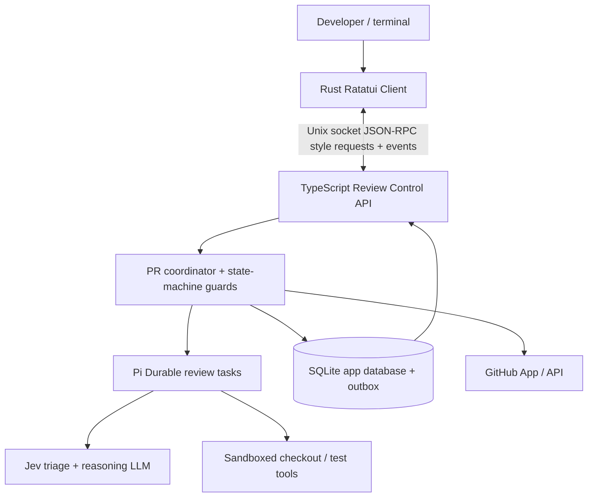

# PR Reviewer TUI — Ratatui Client Specification

**Status:** Implementation-ready proposal · v1.0  
**Date:** 2026-10-20  
**Companion:** `SPEC.md` (Durable PR Review Agent)  
**Primary language:** Rust  
**UI:** Ratatui + Crossterm + Tokio  
**Existing engine:** TypeScript, Pi Durable, state machines, Jev, GitHub App  
**Scope:** A local-first, interactive terminal client. **Do not migrate agent logic into Rust.**

## 1. Product intent

Build a fast, keyboard-first *review workstation* for a durable PR review agent. A developer should be able to list tracked PRs, start or attach to a review, see exactly what the agent is doing, inspect diffs and supporting evidence, review finding history, and explicitly approve publication if configured. Exiting the UI must not terminate a running review.

The interface is not a stream-of-consciousness agent chat. It is an evidence-first interface over persistent workflow state. Show phase, revision, findings, tool activity, errors, and provenance; raw LLM text is secondary and never mistaken for a confirmed finding.

### Goals
1. Attach/reconnect to any review without losing continuity.
2. Make the active state-machine phase and pending work obvious.
3. Let users navigate PRs, files, diffs, findings, verification evidence and timeline without leaving the terminal.
4. Support explicit, safe commands (start, cancel, retry, request reinvestigation, publish when authorized).
5. Never duplicate GitHub submissions, lose events silently, or render stale results as current.
6. Work read-only against the service by default; enable write commands only by server capability and policy.
7. Remain responsive to terminal resizing, stream bursts, disconnects and large diffs.

### Non-goals (MVP)
- Reimplementing Pi Durable, Jev or the agent state machines in Rust.
- Running shell commands directly from the UI against PR code.
- Editing/pushing PR branches, approving/merging PRs automatically.
- Embedding a full git editor or a general-purpose chat client.
- Supporting simultaneous remote multi-user editing; the protocol may accommodate this later.

## 2. Architecture and ownership



**Ownership rules**
- TypeScript service is the **source of truth** for PR/revision state, finding disposition, authorized transitions and publication.
- Pi Durable persists task checkpoints and agent conversations. UI activity **never** controls Pi Durable checkpoints directly.
- Rust owns presentation state only: selected PR, tabs, viewport, filters, modal state, local connection status.
- A UI-issued command requests an action; the server validates capabilities, current revision, state-machine guards and idempotency.
- GitHub is authoritative for actual published comments; the service reconciles external side effects.

### Process topology
- `pr-reviewer daemon`: background TypeScript service, independently supervised/restarted.
- `pr-reviewer tui`: Rust binary connecting to daemon; exit closes only client.
- For developer convenience, an optional launcher may offer to start a *separately managed* local daemon, but never kill it on UI exit.
- Default local transport: `unix://$XDG_RUNTIME_DIR/pr-reviewer/reviewer.sock`; fallback to a user-private runtime path if the variable is absent. **Never create a world-writable socket.**
- Remote future option: authenticated HTTPS + SSE/WebSocket; do not couple domain message types to Unix sockets.

## 3. User journeys

### A. Open/attach
1. Run `pr-reviewer tui`.
2. Client negotiates protocol and receives a snapshot of PRs/runs and capabilities.
3. Select a PR; details show pinned base/head SHAs, latest run, phase, counts and freshness.
4. On an active run, stream its phase transitions, tool activities, verification progress and findings.
5. Quit using `q`; review continues in daemon.

### B. Inspect finding
1. Select a finding from the Review view.
2. Press Enter for Finding Detail: severity, confidence, evidence, affected paths, linked line, current disposition and earlier appearances.
3. Press `d` to open the Diff viewer at the anchored location; jump to source/evidence references.
4. If policy permits, request *reinvestigation* (not arbitrary transition) with optional short reason.

### C. Start/retry/cancel
1. Choose repo/PR (or launch `pr-reviewer tui --pr <url>`).
2. Request start. Show confirmation with target head SHA.
3. Server returns accepted/denied plus authoritative run ID; UI waits for events.
4. Cancel and retry are guarded server commands, requiring a confirmation modal when destructive or costly.

### D. Publish
1. MVP may run in automatic advisory-publishing mode or explicit human approval mode, determined by server policy.
2. In approval mode, Preview shows the exact review summary and candidate inline comments, commit SHA and destinations.
3. User confirms publication, passing snapshot/revision preconditions and idempotency key.
4. Server re-checks current head SHA and publication outbox before GitHub write.
5. UI shows pending, published, superseded, rejected or uncertain outcomes; never assume a successful publish from command acceptance alone.

### E. Reconnect
1. Connection lost → persistent status banner and disabled write controls.
2. Reconnect with jittered backoff, fetch fresh snapshot or resume events after last applied sequence.
3. If replay unavailable or gap detected, replace state from authoritative snapshot.
4. Highlight when viewed run/revision has become stale due to new head SHA.

## 4. Layout and design language

**Visual direction:** dense, quiet, legible, developer-tool aesthetic. No gradient, ASCII art overload, or constantly changing animations. Default dark theme with accessible contrast; light theme and `NO_COLOR`/monochrome mode supported eventually.

### Main shell (suggested 120×38)

```text
┌ PR REVIEWER ────────────────────────────── connected ● local ────────── ? ┐
│ Inbox  Review  Diff  Timeline  Settings                                │
├─────────────────────────┬───────────────────────────────────────────────┤
│ TRACKED PRS             │ #184 Booking availability                   │
│ > #184 Booking API      │ repo/example · head a81f3c2 · VERIFY       │
│   #183 Auth tokens      │ Collect ✓  Analyze ✓  Verify ◐  Publish ·  │
│   #182 Fix caching      ├───────────────────────────────────────────────┤
│                         │ FINDINGS                                      │
│ filters: active/high    │ > ▲ HIGH Race condition       pending verify │
│                         │   ● MED Missing validation    verified       │
│                         ├───────────────────────────────────────────────┤
│                         │ RECENT ACTIVITY                              │
│                         │ 13:41 Read reservations.ts                   │
│                         │ 13:42 Inspect transaction boundaries        │
│                         │ 13:43 Test result attached                   │
├─────────────────────────┴───────────────────────────────────────────────┤
│ j/k move  Enter inspect  d diff  t timeline  / search  ? help  q quit  │
└─────────────────────────────────────────────────────────────────────────┘
```

### Responsive breakpoints
- **Wide >= 110 columns:** navigation sidebar (28–35 cols) + main content + optional context pane.
- **Medium 80–109 columns:** navigation sidebar + main content; detail shown in focused overlay/full area.
- **Narrow 60–79 columns:** one pane at a time, compact status and tabs, no horizontal overflow.
- **Below 60×16:** graceful minimal mode with a resize hint and essential keyboard access; never panic.
- Recompute rectangles on every resize with Ratatui `Layout`, preserve selected entity and scroll position as far as possible.

### Color and semantics
- Neutral: text, muted metadata, panel borders.
- Green: completed/verified; amber: pending/uncertain; red: failed/high severity; blue: active/in progress.
- Pair status with a word/icon; never convey meaning solely by color.
- Make current vs stale revision clearly distinguishable at all times.
- Use Unicode where supported; ASCII fallback (`--ascii`).

## 5. Screens and components

### 5.1 Inbox (default)
- Repository selector, tracked PR list, last activity, head SHA (abbreviated), review state, findings by severity, unread/stale indicators.
- Filters: repo, state, severity, review freshness, assigned to me (if available).
- Search by PR number/title/branch; stable sorting by most recently changed, with optional risk sort.
- Empty state differentiates "no tracked PRs", "filters hide all", and "service unavailable".

### 5.2 Review
- Header: PR title, author (if available), branch, base/head SHA, last sync, active run ID.
- Stepper: `COLLECT_CONTEXT → ANALYZE → VERIFY → PUBLISH → COMPLETED`; separately indicate FAILED, SUPERSEDED, CANCELLED.
- Finding list: severity, status, file/line, fingerprint, confidence and evidence availability.
- Detail panel: exact evidence, tests, reasoning *summary*, linked GitHub comment and previous revision status.
- Activity feed: tool started/completed, phase changed, candidate created, finding disposition changed, verification check passed/failed; redact secrets.
- While a run is live: its phase with the time it has run, and "last activity Ns ago" once it goes quiet for 10 s. When the daemon sends `tool.activity` spans, the feed is a lite waterfall instead: one time axis fit to the width, a row per phase, step, model turn and tool call under its parent, open spans growing to a `┊` now line (`:` with `--ascii`).
- Cost/tokens/elapsed time only when actual metrics are supplied; never synthesize estimates or fake precise progress percentages.
- CTA capabilities derived from server: start, cancel, retry, reinvestigate, preview/publish.

### 5.3 Diff
- File tree with added/modified/deleted/binary counts and risk markers.
- Unified diff first; optional side-by-side when width >= 140.
- Syntax-highlight patch with line numbers, hunk headers and whitespace-aware wrapping; file tabs optional.
- Inline markers for findings with severity/status; Enter opens focused evidence.
- Navigation: next/previous file, hunk, finding; jump to `path:line`, copy path/SHA.
- Huge diff strategy: server-side paginated hunks / local lazy rendering with capped memory; show "truncated" explicitly. Binary or missing patches show metadata only.
- Always pin the rendered diff to a known base/head revision and label stale diffs.

### 5.4 Timeline
- Sequence of revision events: webhook received, run started, phase transitions, candidate → verified/discarded, publication requested/completed, superseded, restart/recovery.
- Each entry: timestamp, actor (`system`, `agent`, `human`, `github`), stable event ID, run/revision association and payload summary.
- Filter by run, phase, event category, finding ID; Enter opens detail and linked references.
- Never expose raw hidden chain-of-thought. Show structured observations, tool metadata, short agent-produced rationales and sanitized outputs.

### 5.5 Finding detail / publication preview
- Finding detail: title, category, severity, confidence, affected line(s), scenario, cited code references, reproducible evidence, current/previous status and GitHub URL.
- Publication preview: exact summary and each inline comment, target SHA, file/path/line and any GitHub API positioning limitations.
- Confirmations clearly distinguish *request accepted* from *side effect completed*.

### 5.6 Settings / diagnostics
- Connection endpoint, server protocol/version, GitHub auth readiness status (never display tokens), active repository, theme, keybinding help, logging level and reconnect status.
- Diagnostics: event sequence, snapshot watermark, time since last heartbeat, recent API errors.

## 6. Keyboard navigation

| Key | Global/default action |
|---|---|
| `j` / `k` or arrows | Move selection |
| `h` / `l` | Left/right pane or collapse/expand |
| `Enter` | Open selected item |
| `Esc` | Close modal/back |
| `Tab` / `Shift+Tab` | Cycle focus panes |
| `1` `2` `3` `4` | Inbox / Review / Diff / Timeline |
| `/` | Focus search/filter |
| `d` | Jump to selected finding's diff |
| `t` | Jump to associated timeline |
| `n` / `N` | Next/previous finding (Diff/Review) |
| `r` | Refresh authoritative snapshot |
| `s` | Request start review (where allowed) |
| `R` | Request retry (confirmation) |
| `c` | Request cancellation (confirmation) |
| `p` | Preview publication (where allowed) |
| `y` | Confirm only inside an explicit confirmation modal |
| `?` | Contextual help |
| `q` | Quit TUI only |

**Input safety:** disable mutation shortcuts while typing; no single keystroke publishes without explicit confirmation. Input handling and keymaps should be independently unit-tested.

## 7. Protocol contracts

Use a versioned transport-independent JSON contract in `packages/protocol`. The Rust `serde` and TypeScript/Zod schemas must pass the same fixtures and compatibility tests. Prefer generation from JSON Schema or committed fixtures over duplicate freehand definitions.

### Connection and bootstrap

```json
{ "type": "hello", "protocolVersion": 1, "client": "ratatui", "capabilities": ["snapshots", "events"] }
```

```json
{
  "type": "welcome", "protocolVersion": 1, "serverVersion": "0.1.0",
  "sessionId": "session-123", "capabilities": ["review.start", "review.cancel", "review.retry", "review.publish"],
  "streamEpoch": "epoch-1", "latestSequence": 108
}
```

### Snapshot

```json
{
  "type": "snapshot", "streamEpoch": "epoch-1", "sequence": 108,
  "prs": [{ "id": "repo#184", "repository": "owner/repo", "number": 184, "title": "Booking API", "headSha": "a81f3c2", "lifecycle": "ACTIVE" }],
  "runs": [{ "id": "run-184-3", "prId": "repo#184", "headSha": "a81f3c2", "phase": "VERIFY", "status": "RUNNING" }],
  "findings": []
}
```

For initial load or high-volume data, support pagination and filtered read endpoints. The simple full snapshot is acceptable for the local MVP.

### Event envelope

```json
{
  "type": "event", "id": "evt-109", "streamEpoch": "epoch-1", "sequence": 109,
  "occurredAt": "2026-10-20T13:01:00Z", "prId": "repo#184", "runId": "run-184-3",
  "eventType": "finding.updated", "data": { "findingId": "f-12", "status": "verified" }
}
```

Events include `pr.updated`, `run.started`, `review.phase_changed`, `finding.updated`, `tool.activity`, `review.publication_changed`, `review.completed`, `run.superseded`, `run.failed` and `heartbeat`. Event ordering is guaranteed **within a stream epoch**; missing sequence → request resync. Emit events only after corresponding durable application state is committed.

### Commands and responses

```json
{
  "type": "command", "requestId": "req-uuid", "command": "review.start",
  "params": { "prId": "repo#184", "expectedHeadSha": "a81f3c2" },
  "idempotencyKey": "review.start:repo#184:a81f3c2"
}
```

```json
{
  "type": "command.result", "requestId": "req-uuid", "status": "accepted",
  "operationId": "op-234"
}
```

- Accepted is **not** completed; a subsequent event confirms the result.
- All mutating commands carry a `requestId`, authorization context (from connection, never caller-selected identity), idempotency key and expected relevant state/revision.
- Publish requires `previewId` or content digest, expected SHA and capability; never accept model-produced review text directly from the TUI as a bypass.
- Error codes: `UNAUTHORIZED`, `CAPABILITY_DENIED`, `INVALID_TRANSITION`, `REVISION_STALE`, `NOT_FOUND`, `CONFLICT`, `RATE_LIMITED`, `TEMPORARILY_UNAVAILABLE`, `INTERNAL_ERROR`.
- Make protocol version mismatch visible and fail safely. Forward-compatible clients ignore unknown event types and preserve known data.

### Recovery semantics
- On connection: negotiate → read authoritative snapshot at sequence N → consume events with sequence > N.
- If stream resumes without snapshot: specify previous `streamEpoch` and last applied sequence; server either replays or demands full resync.
- Duplicate events are ignored by `(epoch, sequence)`; old epochs trigger snapshot reload.
- Use bounded client queues. On overflow, drop transient progress updates before durable domain events; if consistency is uncertain, force resync.
- Heartbeat and idle disconnect detection should be configurable and never masquerade as run failure.

## 8. Rust application design

Use a reducer-style Elm architecture: `Model` + `Msg` → `update` → optional `Effect`; rendering is pure and separate from networking.

```rust
pub enum Msg {
    Key(KeyEvent),
    Resize(u16, u16),
    SnapshotReceived(Snapshot),
    DomainEvent(DomainEvent),
    CommandResult(CommandResult),
    ConnectionChanged(ConnectionState),
    Tick,
}

pub struct AppModel {
    pub connection: ConnectionState,
    pub domain: DomainCache,
    pub selection: Selection,
    pub screen: Screen,
    pub modal: Option<Modal>,
    pub last_sequence: Option<u64>,
}
```

This is a design sketch, not a final compile-checked API. Domain cache keys are stable IDs, never list indexes. Keep network tasks in Tokio and pass typed messages into a bounded MPSC channel. Update state in one event loop; do not share mutable widgets across tasks.

### Suggested crates
- `ratatui`, `crossterm` — widgets and terminal backend.
- `tokio` — async socket IO and task supervision.
- `serde`, `serde_json` — typed protocol messages.
- `uuid` — request IDs.
- `similar` — diff parsing/metadata (if useful); `syntect` or `two-face` — syntax themes; benchmark before large-scale highlighting.
- `color-eyre`/`thiserror` — app and domain errors.
- `tracing`, `tracing-subscriber` — structured diagnostics.
- `unicode-width` — terminal-safe truncation.

Dependency versions should be resolved and locked at implementation time; use compatible maintained releases.

### Threading / event loop
1. Terminal input task sends keyboard, mouse (optional), resize events.
2. Network task handles connect, snapshot, events, commands, reconnect.
3. App reducer applies messages and determines render invalidation.
4. UI redraws on meaningful changes; cap redraw frequency under high event throughput.
5. On panic or normal exit, restore alternate screen, cursor and raw-mode safely via RAII guard.
6. Log to a file rather than stdout while terminal is active.

## 9. Diff and provenance contract

- The daemon exposes `diff.get(prId, baseSha, headSha, file?, cursor?, limit?)` and `finding.get(findingId)`.
- Every diff chunk includes both SHAs, path, hunks, line mapping and truncation/continuation metadata.
- Finding anchors refer to head revision and GitHub-compatible file/line/side where available.
- If an anchor is invalidated by a new commit, display a stale badge and allow viewing the historical revision; do not silently remap.
- Evidence attachments are bounded, sanitized and typed: code reference, tool summary, test result, reproducible scenario, external link.
- Binary diffs and vendor/generated files get explanatory placeholders; do not attempt arbitrary decoding.

## 10. Security, privacy and trust boundaries

- Files/diff/PR descriptions are **untrusted display data**. Sanitize ANSI/OSC escape sequences and control characters before rendering or writing logs. Prevent terminal escape injection.
- Review events and tool outputs may contain secrets; redact in daemon before streaming, and maintain client-side defensive redaction where feasible.
- Unix socket directory mode `0700`; socket access restricted to owning user. Resolve symlink/path issues safely.
- No long-lived GitHub or model credentials in the TUI. Service alone owns secrets and permissions.
- Commands are validated server-side, not solely gated by disabled UI elements.
- Clipboard and external URL opening must be explicit user actions; URL schemes allowlisted.
- Never execute PR-provided instructions/commands from the TUI; test execution remains in isolated backend sandbox.
- Never expose hidden model reasoning or unrestricted raw conversation content in UI/logs; show auditable summaries and evidence.
- Publication must obey review outbox and reconciliation protocol from core spec.

## 11. Repository integration

```text
pr-reviewer/
├── apps/
│   ├── server/                 # existing TS daemon + control API
│   ├── cli/                    # existing headless commands
│   └── tui/
│       ├── Cargo.toml
│       ├── rust-toolchain.toml
│       ├── src/
│       │   ├── main.rs
│       │   ├── terminal.rs
│       │   ├── app.rs
│       │   ├── model.rs
│       │   ├── update.rs
│       │   ├── input.rs
│       │   ├── protocol.rs
│       │   ├── client.rs
│       │   ├── theme.rs
│       │   ├── views/{inbox,review,diff,timeline,settings}.rs
│       │   └── widgets/{phase_stepper,finding_list,activity,diff_hunk}.rs
│       ├── tests/
│       └── snapshots/
├── packages/
│   ├── protocol/               # TS schemas + JSON Schema + fixtures
│   ├── core/
│   ├── agent/
│   ├── github/
│   └── storage/
└── docs/
    ├── SPEC.md
    └── TUI_SPEC.md
```

If toolchains do not share a build system, use a small workspace script to run schema checks, TypeScript tests, Cargo tests and formatting. Do not force Rust into the TypeScript bundler.

## 12. Implementation milestones

### M0 — Protocol and test server
- Extract domain DTOs, commands and events into versioned schemas.
- Implement daemon socket handshake, PR list/snapshot, stream epochs and sequences.
- Include fixture server with synthetic PRs and playback, allowing TUI work without real GitHub/model credentials.
- **Done when:** TS/Rust fixture contract tests pass, and event replay/resync behavior is deterministic.

### M1 — Navigable, read-only TUI
- Terminal lifecycle, layout breakpoints, inbox/review pages, keyboard focus, help modal.
- Attach to daemon, show current PR/revision/phase/findings and reconnect status.
- No mutating commands yet.
- **Done when:** can open/quit/reconnect repeatedly without affecting a running review; all layouts behave at 60×16, 80×24, 120×38.

### M2 — Diff and evidence workstation
- Diff viewer with file/hunk navigation, syntax highlighting, inline markers and finding detail.
- Timeline events filtered by PR/run/finding.
- Paginated loading and explicit truncation/staleness.
- **Done when:** a finding can be traced to pinned code and verification evidence using only keyboard controls.

### M3 — Controlled review actions
- Start, cancel, retry, request reinvestigation, preview and approve publication (only where backend policy allows).
- Confirmation dialogs, capability checks, revision preconditions and command-result reconciliation.
- **Done when:** repeated/replayed commands do not cause duplicate reviews or GitHub posts; stale publish blocked by service.

### M4 — Polish and distribution
- Theme/monochrome, compact mode, accessible labels, filters/search, performance tuning, installable binary.
- Diagnostic screen, graceful offline mode, documentation and help overlays.
- **Done when:** validated across macOS/Linux supported terminals; predictable performance for large repos.

## 13. Acceptance tests

### Unit tests
- Reducer event handling and selection stability on list reorder.
- Keyboard focus, modal priority, shortcuts while input active.
- Formatting/truncation of Unicode and terminal-control stripping.
- Diff anchor mapping, stale revision presentation.
- Duplicate event suppression and stream epoch transitions.

### Integration tests
- Socket handshake with mismatched protocol versions.
- Snapshot N + events N+1 without gaps, loss and resync, reordered/duplicate event replay.
- Disconnect/reconnect while `VERIFY` is executing.
- No review cancellation on TUI exit.
- Server rejects unauthorized/invalid/stale commands even when client sends them.
- Publication accepted → pending → GitHub reconciled; no double-post after service crash/retry.

### Visual/golden tests
- Golden terminal frames for Inbox, Review, Diff, Timeline at 60×16, 80×24, 120×38, 160×45.
- Empty/loading/error/stale/long-title/binary-diff fixtures.
- Color-blind/monochrome semantic labels and active focus indicator.

### Performance targets (initial, measure and tune)
- Typing/selection remains responsive with thousands of events and hundreds of findings.
- Cap event-feed memory (e.g. last 2,000 rendered activities); older entries fetched via pagination.
- Avoid full syntax re-highlight on every input; cache per diff chunk and theme.
- No unbounded channels, runaway redraw loops or history accumulation in UI state.

## 14. Operational commands and configuration

```bash
pr-reviewer daemon
pr-reviewer tui
pr-reviewer tui --pr https://github.com/owner/repo/pull/184
pr-reviewer tui --socket /path/to/reviewer.sock
pr-reviewer tui --ascii
```

Example config (user-local, not a credentials file):

```toml
[connection]
socket = "auto"
reconnect = true

[ui]
theme = "dark"
start_view = "inbox"
show_activity = true
ascii = false
```

Environment and paths should follow XDG conventions on Linux and sensible application-support directories on macOS. Explicit CLI flags override config. Do not allow remote network exposure without authentication and TLS.

## 15. Open decisions (non-blocking defaults)

1. **Transport:** Unix socket with newline-delimited JSON for MVP; retain protocol boundary for future WebSocket/SSE.
2. **Command mode:** Advisory/read-only by default; gated mutating commands added M3.
3. **Publication UX:** Server policy chooses automatic vs confirmation-required. TUI cannot override.
4. **Event history:** Persistent backend event journal is required for replay; transient tool updates may be coalesced.
5. **Packaging:** Rust TUI distributed as native binary; TypeScript daemon deployed separately.
6. **Theme:** Dark, restrained, minimal animations; terminal capability detection.

## 16. First coding session checklist

- [ ] Read `SPEC.md` and inspect existing repo before creating files.
- [ ] Define `v1` JSON schemas for `hello`, `welcome`, snapshot, event envelope, command and result.
- [ ] Add TypeScript fixture server and Rust protocol tests.
- [ ] Scaffold Ratatui app with terminal RAII cleanup, Tokio channels and reducer architecture.
- [ ] Implement Inbox with selectable PRs from snapshot (initially fixtures).
- [ ] Render Review phase and finding list; expose status of real connection.
- [ ] Ensure quitting TUI leaves daemon and active Pi Durable reviews untouched.
- [ ] Add reconnection + snapshot resync test before command controls.

---

**North star:** The terminal should make an AI review *inspectable, controllable and trustworthy* without turning a durable background reviewer into a fragile interactive session.
